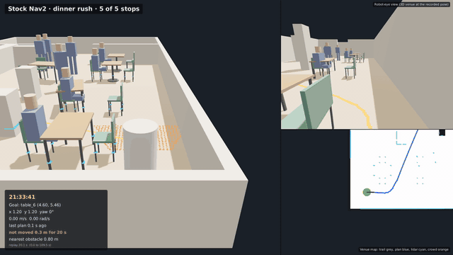

# ANEWS

**Find your delivery robot's Nav2 failures in simulation, before lunch service does.**

<p align="center">
  <a href="https://github.com/NelsenEW/ANEWS/releases/download/v0.1.0/dinner-rush.mp4"></a>
</p>

ANEWS simulates a restaurant shift (tables that moved since the map was made, guests, waiters, a pram in the aisle) and drives **your real, unmodified Nav2 stack** through it over ROS 2 Zenoh. It records every run, scores each delivery, and renders the run to video on the GPU, so you can see a stall before a customer does.

I'm Nelsen, co-founder of [FoodLink System](https://foodlinksystem.com). We run delivery robots in working restaurants in Malaysia. Most of our navigation bugs only showed up at lunch: a table pushed 30 cm, a chair pulled out, a queue at the pass. I used to tune Nav2 on the restaurant floor, by trial and error, with the robot out of service. ANEWS is how I stopped doing that.

## Try it (one command, no ROS install)

```bash
git clone https://github.com/NelsenEW/ANEWS && cd ANEWS/demo && docker compose up
```

This builds two containers, stock Nav2 (ROS 2 Kilted, `nav2_bringup`, `rmw_zenoh`) and `anews` (the first build takes 10 to 20 minutes), then sends the robot to five stops through the dinner rush. No GPU is needed for this part: the demo senses on the CPU. When it finishes, `demo/out/summary.json` holds the outcome of each stop and `demo/out/replay-dinner_rush.jsonl` the whole run.

Turn the run into a video (needs an NVIDIA GPU and an ffmpeg with `h264_nvenc`; frames are drawn with wgpu):

```bash
cargo install --locked --path anews-rs/crates/anews
anews render demo/out/replay-dinner_rush.jsonl --venue venues/demo_cafe/venue.yaml --scene dinner_rush --out dinner-rush.mp4
```

## What the demo shows

Stock Nav2 drives the dinner rush: the ROS 2 Kilted `nav2_bringup` params with the MPPI controller, plus the robot footprint and the depth cloud ([`demo/nav2/nav2_params.yaml`](demo/nav2/nav2_params.yaml)).

| Stop | Result | Time | Path |
|---|---|---|---|
| table 6 | arrived | 13.8 s | 5.8 m |
| table 7 | arrived | 13.9 s | 5.0 m |
| kitchen pass | arrived | 7.8 s | 2.1 m |
| table 3 | arrived | 14.9 s | 4.9 m |
| home | arrived | 19.2 s | 7.0 m |

5 of 5 stops, 0 bumps, 110 s of simulated service at real-time speed, sensed on the GPU. Rendering that run to 1080p took 12 s.

The first version of the demo cafe had a bug: every chair was a metre wide, because the venue left out their size. Nav2 stalled a metre short of table 6, reported "Failed to make progress" three times, and gave up after 120 s. The replay showed four chair legs exactly where the robot wanted to park. That is the point of ANEWS: a failure shows up in a replay, with the evidence, instead of on the restaurant floor.

## What you get

| | |
|---|---|
| **Your Nav2, untouched** | ANEWS is the robot, not the planner. It publishes `/clock`, `/odom`, `/tf`, `/scan` and a depth cloud, and takes `/cmd_vel`. Goals go to Nav2's own `/goal_pose`. Nothing in your stack changes. |
| **Rust end to end** | One `anews` binary. It speaks ROS 2 over Zenoh directly, so the host needs no ROS install. |
| **GPU sensing at fleet scale** | Lidar and depth rays are traced on the GPU with hardware ray queries. On one RTX 3060, the full rig (1,369 lidar beams and a 160×120 depth image) for 1,024 robots takes 93 ms: about 550 robots sensed at 20 Hz. Measure yours with `cargo run --release --manifest-path anews-rs/Cargo.toml -p anews-raycast --example sense_bench`. |
| **Restaurants as data** | A venue is a floor-plan map plus a YAML list of tables, chairs, counters and people. A *scene* says what changed since the map was made. See [`venues/demo_cafe`](venues/demo_cafe/venue.yaml). |
| **Missions you can score** | `anews sim batch` runs N robots on one sim clock and writes arrived, timeout or no-plan for every stop, plus path length and bumps. |
| **Video from any run** | `anews render` turns any run into 1080p H.264 on the GPU: the scene, the robot, its lidar and depth returns, and Nav2's plan. |

## How it works

```
 venue.yaml + scene ──► anews ── /scan, depth, /odom, /tf, /clock ──► Nav2 (your params)
                          ▲                                             │
                          └──────────────── /cmd_vel ◄──────────────────┘
                          │
                          └─► replay.jsonl ─► anews render ─► mp4
```

`anews` owns the clock. It steps the robot's differential drive, checks contact with furniture and people, traces the sensors against the scene, and publishes everything with sim time. Nav2 sees a robot, not a simulator.

## Use it on your robot

1. Make a venue: your map plus the furniture that matters (`anews venue check venues/<yours>/venue.yaml`).
2. Write a batch spec like [`demo/dinner_rush.yaml`](demo/dinner_rush.yaml): start pose, stops, sensor mounts, footprint.
3. Start your Nav2 with `RMW_IMPLEMENTATION=rmw_zenoh_cpp` and your own params, then run `anews sim batch your_spec.yaml --out out`.

Change one parameter, run the batch again, compare the two `summary.json` files.

## Status

ANEWS is young and I'm building it in public.

- Works today: 3D venues and scenes, GPU and SIMD sensing, a live link to stock Nav2, multi-robot batches, replay, and GPU video.
- Next: importing a real robot's recording as a scene, so a stall from last Friday becomes a test case; then a skill so Claude Code or Codex can propose a Nav2 change and prove it on the batch.

Follow along: [foodlinksystem.com](https://foodlinksystem.com).

## Licence

Apache-2.0. Copyright 2026 Nelsen Edbert Winata.
